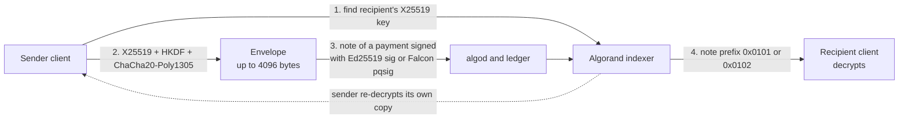

> **This repository has moved.** Development continues in [CorvidLabs/algochat](https://github.com/CorvidLabs/algochat). This copy stays public so existing package versions keep resolving. Open new work in the monorepo.

# AlgoChat Protocol

[](https://github.com/CorvidLabs/protocol-algochat/blob/main/LICENSE)
[](https://corvidlabs.github.io/protocol-algochat/)

Encrypted, immutable annotations for Algorand transactions.

## What Is This?

AlgoChat is a protocol for attaching **end-to-end encrypted messages** to Algorand transactions. Think of it as cryptographic memos that only the sender and recipient can read, permanently recorded on-chain.

**This is not a general-purpose messaging app.** For everyday chat, use Signal or Matrix. AlgoChat serves a specific niche: encrypted communication that is provably tied to blockchain transactions.

## Use Cases

- **Payment Memos** - Attach private notes to payments ("Invoice #1234", "March rent")
- **On-Chain Attestations** - Cryptographic proof that you said X to Y at time Z
- **Transaction Receipts** - Encrypted confirmation details readable by both parties
- **Audit Trails** - Immutable, timestamped communication records
- **Escrow Instructions** - Private terms attached to smart contract interactions

## Limitations

Be aware of what this protocol cannot do:

| Limitation | Details |
|------------|---------|
| **3954-byte messages** | Maximum plaintext size (standard mode); 3950 bytes in PSK mode. The note itself is at most 4096 bytes. No images, files, or long texts. |
| **Metadata visible** | Sender/recipient addresses and timing are public on-chain |
| **No message deletion** | Blockchain is immutable; messages persist forever |
| **Cost per message** | Scheme minimum for the first 1024 note bytes: ~0.001 ALGO (Ed25519) or ~0.003 ALGO (Falcon-1024). A 4096-byte note is 1,308 or 3,308 µAlgo at a 1,000 µAlgo min-fee (see [Economics](#economics)) |
| **4.5s latency** | Algorand block finality time |
| **No deniability** | Sender attribution is included in the envelope |

## Economics

Each message pays the Algorand scheme minimum, which covers the first 1024 note bytes. Note bytes past 1024 add a surcharge, computed in integers:

```
surcharge = ceil((max(0, noteBytes - 1024) * minFee) / 10000)
fee       = schemeMinimum + surcharge
```

The scheme minimum is one min-fee for Ed25519 and three for Falcon-1024. A note of 4097 bytes is not legal. The formula and the integer division form are in [PROTOCOL.md §10.3](PROTOCOL.md#103-fees).

Confirmed fees at a 1,000 µAlgo min-fee:

| Note bytes | Authorizing scheme | Fee |
| --- | --- | --- |
| 1024 | Ed25519 (`sig`) | 1,000 µAlgo (0.001 ALGO) |
| 1024 | Falcon-1024 (`pqsig`) | 3,000 µAlgo (0.003 ALGO) |
| 2000 | Ed25519 (`sig`) | 1,098 µAlgo |
| 4096 | Ed25519 (`sig`) | 1,308 µAlgo |
| 4096 | Falcon-1024 (`pqsig`) | 3,308 µAlgo |

The 25-word mnemonic is the master secret. New accounts MAY be Falcon-1024.
Importing a phrase without an explicit scheme MUST recover the Ed25519
address. Falcon identity does not make the X25519 envelope quantum-safe;
PSK mode still covers that. Staking rewards can offset fees:

**Staking Options:**

| Method | Minimum | Notes |
|--------|---------|-------|
| Solo staking | 30,000 ALGO | Run your own node |
| Delegated staking | 30,000 ALGO | Delegate to a node operator |
| Liquid staking | Any amount | Via protocols like Folks Finance |
| Staking pools | Any amount | Community-operated pools |

**Example at ~5% APY:**

| ALGO Staked | Annual Rewards | Messages Funded/Year |
|-------------|----------------|----------------------|
| 30,000 | ~1,500 ALGO | ~1,500,000 |
| 100,000 | ~5,000 ALGO | ~5,000,000 |

*Note: APY rates are illustrative and vary by governance period. Actual rewards depend on total network participation and governance proposals. Check current rates at [Algorand Foundation](https://algorand.foundation). The message counts above price a note of 1024 bytes or fewer (1,000 µAlgo). A 4096-byte Ed25519 note is 1,308 µAlgo at the same min-fee, so the same rewards fund fewer of those.*

Users with less than 30K ALGO can participate through liquid staking or pools. The more you contribute to Algorand infrastructure, the more utility you extract—active participants get free encrypted communications, while casual users pay minimal per-message fees.

## Security Properties

| Property | Status |
|----------|--------|
| Message content confidentiality | Protected (E2EE) |
| Message integrity | Protected (authenticated encryption) |
| Forward secrecy | **Not protected** (see [PROTOCOL.md §11.1](PROTOCOL.md#111-forward-secrecy--not-provided)) |
| Replay attacks | Protected (blockchain uniqueness + PSK counter) |
| Quantum resistance (key exchange) | Optional (PSK mode provides defense-in-depth) |
| Quantum resistance (account identity) | Optional (native Falcon-1024 `pqsig`; v1.2) |
| PSK session key separation | Optional (100-message blast-radius limit in PSK mode; not forward secrecy) |
| Metadata privacy | **Not protected** (addresses, timing visible) |
| Traffic analysis | **Not protected** |

See [SECURITY.md](SECURITY.md) for the full threat model.

## Architecture

A message is an encrypted envelope in the `note` of an ordinary Algorand payment. There is no server, mailbox, or contract in between.



The [high-level design](docs/HLD.md) walks through the keys, the wire format, encryption and decryption, key discovery, PSK mode, and the on-chain transport, with sequence diagrams for each flow.

## Documentation

| Document | Description |
|----------|-------------|
| [PROTOCOL.md](PROTOCOL.md) | Full protocol specification |
| [IMPLEMENTATION.md](IMPLEMENTATION.md) | Language-agnostic implementation guide |
| [TEST-VECTORS.md](TEST-VECTORS.md) | Canonical test vectors for verification |
| [SECURITY.md](SECURITY.md) | Security considerations and threat model |
| [docs/HLD.md](docs/HLD.md) | High-level design with diagrams |

## Implementations

| Language | Repository | Status |
|----------|------------|--------|
| Swift | [swift-algochat](https://github.com/CorvidLabs/swift-algochat) | Production |
| TypeScript | [ts-algochat](https://github.com/CorvidLabs/ts-algochat) | Active |
| Python | [py-algochat](https://github.com/CorvidLabs/py-algochat) | Active |
| Rust | [rs-algochat](https://github.com/CorvidLabs/rs-algochat) | Active |
| Kotlin | [kt-algochat](https://github.com/CorvidLabs/kt-algochat) | Active |
| Go | [go-algochat](https://github.com/CorvidLabs/go-algochat) | Active, conformance pending |

The conformance harness ([test-algochat](https://github.com/CorvidLabs/test-algochat)) currently covers Swift, TypeScript, Python, Rust, and Kotlin. Go is implemented and being brought into the harness.

## Clients

| Client | Repository | Status |
|--------|------------|--------|
| Angular (web) | [algochat-web](https://github.com/CorvidLabs/algochat-web) | Archived (superseded by Raven) |

See the [Implementation Status Dashboard](https://corvidlabs.github.io/protocol-algochat/status.html) for live test results.

## Technical Summary

### Cryptographic Primitives

| Function | Algorithm | Reference |
|----------|-----------|-----------|
| Key Agreement | X25519 ECDH | RFC 7748 |
| Encryption | ChaCha20-Poly1305 | RFC 8439 |
| Key Derivation | HKDF-SHA256 | RFC 5869 |

These are the same primitives used by Signal, WireGuard, and TLS 1.3.

### Wire Format (v1 Standard - `0x01`)

```
[version: 1][protocol: 1][sender_pubkey: 32][ephemeral_pubkey: 32][nonce: 12][encrypted_sender_key: 48][ciphertext: variable]
```

- **Header size**: 126 bytes (fixed overhead)
- **Max ciphertext**: 3970 bytes
- **Max plaintext**: 3954 bytes
- **Total envelope**: 4096 bytes (Algorand note field limit)

### Wire Format (v1.1 PSK - `0x02`)

```
[version: 1][protocol: 2][ratchet_counter: 4][sender_pubkey: 32][ephemeral_pubkey: 32][nonce: 12][encrypted_sender_key: 48][ciphertext: variable]
```

- **Header size**: 130 bytes (126 + 4-byte ratchet counter)
- **Max ciphertext**: 3966 bytes
- **Max plaintext**: 3950 bytes
- **Total envelope**: 4096 bytes (Algorand note field limit)
- **Hybrid key derivation**: X25519 ECDH + ratcheted pre-shared key

### Transport

Messages are the `note` field of standard Algorand payment transactions:

```
sender  → recipient
amount  = 0 ALGO (or any payment amount)
note    = <encrypted AlgoChat envelope>
fee     = scheme minimum + note surcharge (at a 1,000 µAlgo min-fee: 1,000 or 3,000 µAlgo for 1024 bytes; 1,308 or 3,308 µAlgo for 4096 bytes)
```

## Legal Notice

This software is provided for legitimate uses including:
- Private payment annotations
- Confidential business communications
- Research and educational purposes

**Users are responsible for compliance with applicable laws.** This includes but is not limited to:
- Export controls on cryptographic software
- AML/KYC regulations in your jurisdiction
- Data protection laws (GDPR, CCPA, etc.)
- Sanctions compliance

This protocol does not provide lawful intercept capabilities and cannot comply with key escrow requirements. Consult legal counsel before deploying in regulated environments.

## Contributing

Contributions are welcome. Please read the protocol specification before proposing changes.

## License

MIT License - See [LICENSE](LICENSE) for details.
